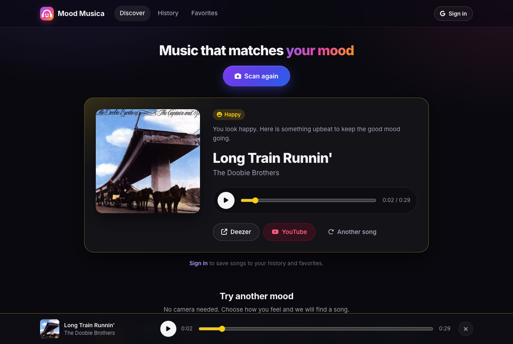
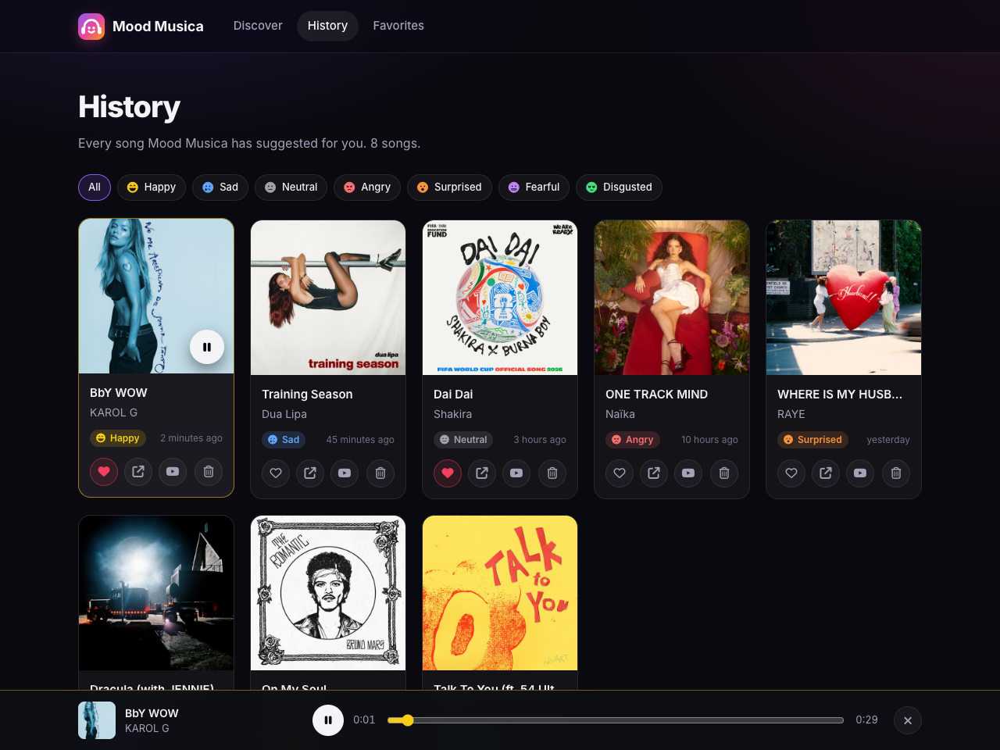
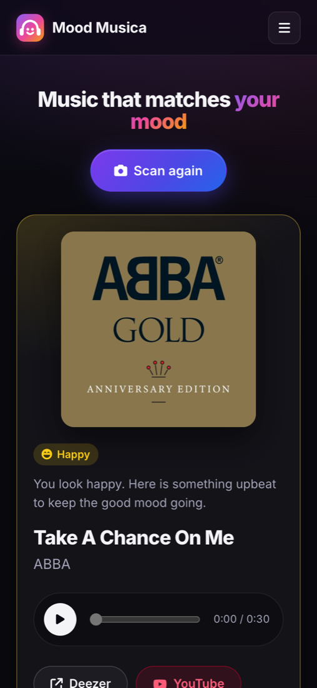

<p align="center">
  
</p>

<h1 align="center">Mood Musica</h1>

<p align="center">
  <strong>Music that matches your mood.</strong><br>
  Mood Musica reads your facial expression right in your browser and recommends a song to match how you feel.
</p>

<p align="center">
  
</p>

## Features

- **Mood detection on your device:** a face-expression model runs in the browser through TensorFlow.js. Hold an expression for two seconds and Mood Musica locks in one of seven moods. Your video never leaves your device.
- **No camera? Pick a mood:** choose Happy, Sad, Angry, Surprised, Neutral, Fearful or Disgusted by hand.
- **Song recommendations:** songs come from playlists curated by Deezer's editors, with a 30-second preview, cover art, and links to the full song on Deezer or YouTube. Ask for another song in the same mood at any time.
- **History and Favorites:** sign in with Google to keep every suggestion and heart your favorites. Filter by mood and play any saved song from its card.
- **Built-in player:** a "Now playing" bar keeps the preview going while you browse.
- **Responsive and accessible:** works on phones and desktops, and every control can be used from the keyboard.

<p align="center">
  
  &nbsp;
  
</p>

## How it works

1. **Detect:** [face-api](https://github.com/vladmandic/face-api) finds your face in the webcam feed and scores seven expressions on every frame.
2. **Stabilize:** a small tracker averages those scores over time, requires a minimum confidence and ignores blinks. The raw scores often tie (for example 0.47 sad and 0.41 happy), so this keeps the reading from flickering.
3. **Recommend:** the Flask API searches Deezer for editor-curated playlists matching the mood, skips holiday playlists, and returns a random track that has a preview.
4. **Save:** when you are signed in, the song is stored under your account in Firebase Realtime Database. Security rules make sure only you can read or change your songs.

## Tech stack

| Part | Built with |
| --- | --- |
| Frontend | React 18, Vite, React Router, @vladmandic/face-api (TensorFlow.js), react-webcam |
| Backend | Python, Flask, Flask-Limiter, gunicorn, requests |
| Music | [Deezer API](https://developers.deezer.com/api) (no API key needed) |
| Accounts and data | Firebase Authentication (Google sign-in) and Realtime Database |
| Tests | pytest, Vitest |

## Project structure

```
backend/
  backend/          Flask app: app.py, routes.py, music.py (Deezer client), moods.py, config.py
  tests/            pytest suite (Deezer is faked, so tests run offline)
frontend/
  src/components/   UI: Home, MoodScanner, SongResult, Library, NowPlayingBar, ...
  src/services/     face detection, songs API, auth, audio player, toasts
  src/utils/        emotion tracker, time and preview-link helpers (with Vitest tests)
database.rules.json Firebase security rules
```

## Getting started

You need Python 3.11+, Node 20.19+ and a free Firebase project.

### 1. Firebase (one time)
1. In the [Firebase console](https://console.firebase.google.com/), create a project and add a **Web app**.
2. **Authentication > Sign-in method**: enable **Google**.
3. **Realtime Database**: create a database, then deploy this repo's security rules:
   ```
   npx firebase-tools login
   npx firebase-tools deploy --only database --project <your-project-id>
   ```

### 2. Backend
```
cd backend
python3 -m venv venv
venv/bin/pip install -r requirements-dev.txt
cd backend
../venv/bin/python app.py
```
The API runs on http://localhost:5001. Optional settings are listed in `backend/.env.example`.

### 3. Frontend
```
cd frontend
cp .env.example .env.local   # then fill in your Firebase web app config
npm install
npm run dev
```
Open http://localhost:5173.

## Tests

```
cd backend && venv/bin/pytest    # API, Deezer client, caching, rate limits
cd frontend && npm test          # emotion tracker, preview link expiry, time formatting
```

## Deploying the backend

Flask's built-in server is for development only. In production, run the API with gunicorn:
```
cd backend/backend
../venv/bin/gunicorn -c gunicorn.conf.py wsgi:app
```
- **Rate limits:** each client IP gets 20 song and 60 preview requests per minute. All clients share caps of 100 and 200 per minute, which keeps the server under Deezer's limit of about 50 requests per 5 seconds. Every limit can be changed in `.env`.
- **Behind a reverse proxy** (nginx, a load balancer): set `TRUSTED_PROXIES=1` so limits apply to the real client IP.
- **More than one process:** the default is one process with 8 threads, which keeps rate limit counters in memory. To run several processes, point `RATELIMIT_STORAGE_URI` at Redis first.
- Set `FRONTEND_ORIGINS` to your deployed frontend URL and keep `FLASK_DEBUG=0`.

## Privacy and security

- Face detection runs entirely in the browser; no images or video are uploaded.
- The backend stores no secrets and no user data. It only talks to Deezer's public API.
- Firebase rules let each user read and write only their own songs, and they validate every field.
- Never commit `.env`, `.env.local` or Firebase service-account keys; `.gitignore` excludes them.

## License

[MIT](LICENSE) © 2024 Rahul Trivedi
